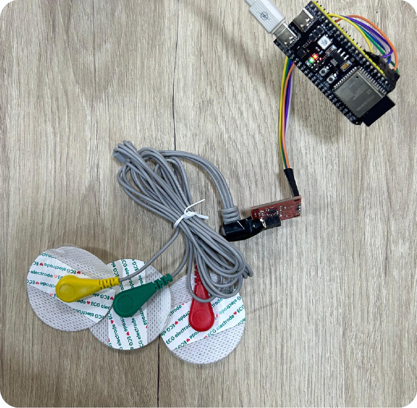
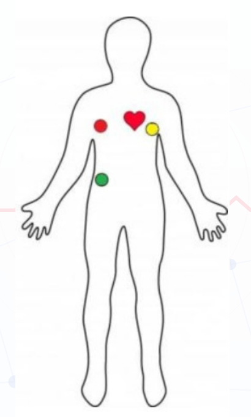
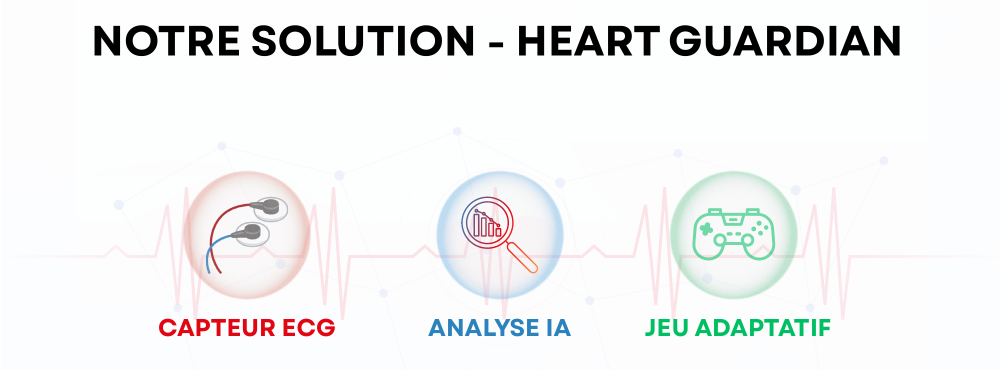
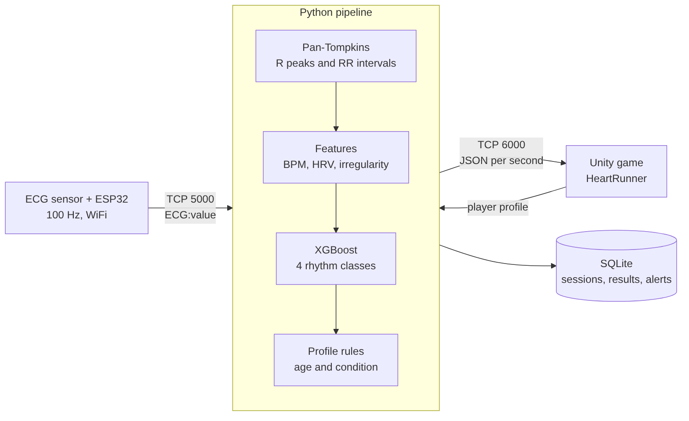

# Heart Guardian

An ECG-driven adaptive game: a wearable ESP32 sensor streams the player's heart signal, a Python pipeline analyses the rhythm with XGBoost, and a Unity game adapts to the player's cardiac state in real time.

[](#overview)
[](#architecture)
[](#ai-model)
[](#communication-protocol)
[](#quick-start)
[](#limitations)
[](#author)


> Play. Feel. Protect your body.

<p align="center">
  
  
</p>

## Overview

Diabetes and obesity are rising fast in Morocco: the International Diabetes Federation reports 2.9 million people living with diabetes in 2024 (4.2 million expected by 2050), and 24 % of adults affected by obesity. Heart Guardian turns physical monitoring into something people want to do by building cardiac tracking into a game.

1. **ECG sensor**: three electrodes and an ESP32 sample the heart signal at 100 Hz and stream it over WiFi.
2. **AI analysis**: R peaks, heart rate, HRV and rhythm irregularity are extracted and classified as normal, bradycardia, tachycardia or danger, with thresholds adapted to the player's age and condition.
3. **Adaptive game**: the Unity game receives one result per second and reacts (normal pace, slow down, breathing pause, safe mode).

Target users: people with diabetes, people with obesity and cardiac risk, players with a cardiac history, and paediatric clinics (playful cardiac rehabilitation).

Built by team **Health Hackers** at the **Game4Health Hackathon** ("Create the game that heals"), an innovation competition organised by the SmartTech Lab of ISMAGI in Rabat on 3-4 April 2026. The team received a certificate of participation. The business model and cost study are in [Documents](#documents).



## Architecture



| Layer | Folder | Role |
|-------|--------|------|
| Sensor | `firmware/ecg_wifi` | Samples the ECG at 100 Hz, detects electrodes off, streams text lines over TCP |
| Backend | `python/` | Signal processing, XGBoost inference, profile rules, SQLite storage, Unity server |
| Game | `unity/` | HeartRunner game that consumes the JSON results (scripts only, see [Unity](#unity)) |
| Tools | `tools/` | ECG emulator and Unity simulator to develop without hardware |

## AI model

- **Pan-Tompkins pipeline** (`pan_tompkins.py`): low-pass 15 Hz, high-pass 5 Hz, derivative, squaring, moving-window integration, adaptive threshold (40 % of the maximum), minimum 0.3 s between peaks. RR intervals outside 0.3 to 2.0 s are discarded.
- **Features** (`feature_extractor.py`): BPM, RR mean / std / min / max, HRV (RMSSD), irregularity (RR std / RR mean), age, condition.
- **Classifier** (`train.py`): XGBoost trained on 10 s segments from the 48 records of the MIT-BIH Arrhythmia Database (downloaded from PhysioNet, normalised to the ESP32 ADC range 0-4095).
- **Profile rules** (`ai_model.py`): age brackets and conditions (hypertension, asthma, arrhythmia, diabetes) can raise the class.
- **Window**: the last 10 s of signal, re-analysed every second.

| Class | Label | Game action |
|-------|-------|-------------|
| 0 | Normal | `continuer_normal` |
| 1 | Bradycardie | `ralentir_jeu` |
| 2 | Tachycardie | `pause_respiration` |
| 3 | Danger | `mode_securise` |

Results are stored in SQLite (`players`, `sessions`, `ecg_results`, `alerts`).

## Communication protocol

**ESP32 to pipeline** (TCP port 5000, one text line per message):

| Message | Meaning |
|---------|---------|
| `ECG:<0-4095>` | One raw 12-bit sample |
| `DECONNECTE` | Electrodes are not attached |

**Unity to pipeline** (TCP port 6000, JSON lines), optional player profile:

```json
{"type": "profil", "nom": "Sara", "age": 14, "maladie": "asthme"}
```

Accepted conditions: `aucune`, `asthme`, `diabete`, `hypertension`, `arythmie`, `autre`. The pipeline answers `{"type": "profil_confirme", "session_id": 2, ...}` and starts a new session.

**Pipeline to Unity** (one JSON line per analysis):

```json
{"type": "ecg_resultat", "bpm": 75, "hrv": 0.021, "rr_moyen": 0.8, "irregularite": 0.03,
 "classe": 0, "label": "Normal", "confiance": 99.2, "alerte": false,
 "action_jeu": "continuer_normal", "message": "Rythme normal a 75 BPM"}
```

If the electrodes come off, Unity receives `{"type": "alerte", "label": "Deconnecte", "action_jeu": "mode_securise", ...}`.

## Quick start

### 1. Backend

```bash
python -m venv venv
source venv/bin/activate          # Windows Git Bash: source venv/Scripts/activate
pip install -r requirements.txt

python python/train.py            # downloads MIT-BIH and trains the model (needs internet)
python python/pipeline.py         # ESP32 on port 5000, Unity on port 6000
```

The model is saved to `data/model/xgboost_ecg.pkl` and the database to `data/heartguardian.db`. Both are git-ignored.

### 2. Try it without hardware

```bash
python tools/ecg_emulator.py 75      # fake ESP32 at 75 BPM (try 45, 130, 170)
python tools/unity_simulator.py      # fake backend for the game (instead of the pipeline)
```

The first analysis appears about 10 s after the emulator connects.

### 3. Flash the ESP32

```bash
cp firmware/ecg_wifi/secrets.example.h firmware/ecg_wifi/secrets.h
```

Edit `secrets.h` (WiFi name, password, and the LAN IP of the computer running the pipeline), check the pins at the top of `ecg_wifi.ino`, then flash with the Arduino IDE. `secrets.h` is git-ignored.

### Configuration

| Variable | Default | Description |
|----------|---------|-------------|
| `HG_HOST` | `0.0.0.0` | Bind address |
| `HG_PORT_ESP32` | `5000` | Port the ESP32 connects to |
| `HG_PORT_UNITY` | `6000` | Port the game connects to |

## Unity

Only the game scripts (`unity/HeartRunner/Assets/Scripts`) and the package manifest are published. The full project is not included because it depends on third-party assets and the Genies SDK, which are large and not redistributable here. To run the game, create a Unity project from the Endless Runner template and import the scripts.

## Documents

- [Project presentation](docs/documents/heart-guardian-presentation.pdf): problem, solution, target users, business model canvas, 6-month roadmap.
- Estimated MVP cost: 2,400 to 3,500 MAD (ECG sensor and ESP32 about 300 to 350 MAD, development 2,000 to 3,000 MAD, 3D-printed sensor case 100 to 150 MAD).

## Limitations

- **Not a medical device.** Heart Guardian is a prototype for games and awareness. It must not be used for diagnosis or treatment decisions.
- Training labels are derived from BPM and RR irregularity rules, not from the cardiologist beat annotations of MIT-BIH, so the model learns those rules rather than clinical arrhythmia types.
- Age and condition are constant during training (30 years, none); they only influence the result through the profile rules.
- Training data is sampled at 360 Hz and inference runs at 100 Hz after normalisation; accuracy on real ESP32 signals has not been clinically validated.
- Signal quality depends on electrode placement; motion during play adds noise.
- The ESP32 firmware was rewritten from the protocol and has not been re-validated against the original hardware wiring; check the pin numbers before use.

## Repository structure

```
heart-guardian-ecg-game/
|-- firmware/ecg_wifi/      ESP32 firmware and secrets template
|-- python/                 Pipeline, AI model, training, database
|-- tools/                  ECG emulator, Unity simulator
|-- unity/HeartRunner/      Game scripts and package manifest
|-- docs/                   Images and presentation
|-- requirements.txt
`-- .gitignore
```

## Team

Team **Health Hackers**, Game4Health Hackathon 2026.

| Member | Field |
|--------|-------|
| [Abdessamad Ait Brahim](https://github.com/abdessamadaitbrahim) | AI engineering |
| [Aya Essebaiy](https://www.linkedin.com/in/aya-essebaiy-698a55341/) | Computer science |
| [Fatima Elmessaoudi](https://www.linkedin.com/in/fatima-elmessaoudi-7bb455346/) | Computer science |
| [Abdenour Cheridou](https://www.linkedin.com/in/abdenour-cheridou/) | Mechatronics |
| [Chaimae Fezzaga](https://www.linkedin.com/in/chaimae-fezzaga-133467323/) | Mechatronics |
| [Nada El Morabit](https://www.linkedin.com/in/nada-el-morabit-5262a234a/) | Mechatronics |
| [Issam Benabar](https://www.linkedin.com/in/issam-benabar/) | Mechatronics |

## Author

**Abdessamad Ait Brahim** - [github.com/abdessamadaitbrahim](https://github.com/abdessamadaitbrahim)
